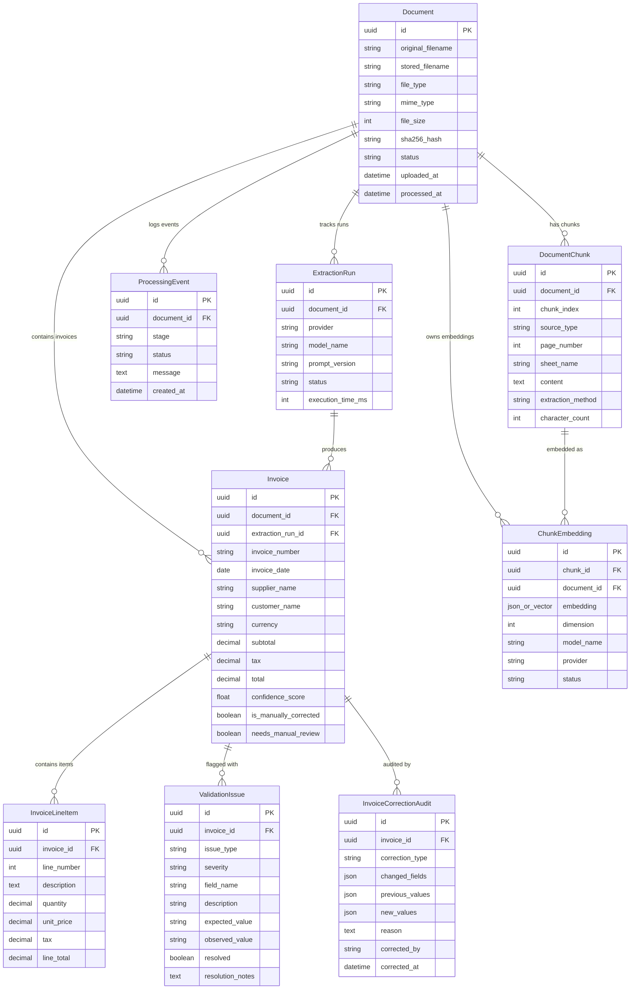

# System Architecture & Technical Specifications

**Project**: AI-Powered Financial Document Intelligence System  
**Document Version**: 2.0 (Post-Audit Release)  
**Last Updated**: November 19, 2026  
**Primary Language / Frameworks**: Python 3.12 (FastAPI, SQLAlchemy 2.0 async, Pydantic v2), TypeScript (React 18, Vite, Tailwind CSS)  
**Database Engines**: SQLite 3 (`aiosqlite` local fallback) / PostgreSQL 16 + `pgvector` (production target)  

---

## 1. Architectural Overview

The application is architectured as a **Modular Monolith** designed for high cohesion, deterministic boundaries, and operational simplicity. It cleanly separates ingestion, parsing, context preparation, LLM extraction orchestration, mathematical validation, vector search, and audit logging into decoupled services.

```mermaid
flowchart TD
    subgraph UI ["Frontend Client (React 18 + Vite + TypeScript)"]
        DASH["Review Dashboard\n(Overview & KPI Metrics)"]
        UPL["Upload Zone\n(Multi-file & Drag-and-Drop)"]
        INV["Invoice Detail Inspector\n(Evidence & Line Items)"]
        CORR["Manual Correction Modal\n(Mandatory Justification)"]
        SRCH_UI["Search Interface\n(Keyword, Semantic, Hybrid)"]
    end

    subgraph API ["REST API Gateway (FastAPI 0.115+)"]
        ROUTERS["API Routers (/api/v1)"]
        DOC_EP["/documents & /upload"]
        EXT_EP["/extract-invoices & /extraction-history"]
        INV_EP["/invoices & /corrections"]
        VAL_EP["/validate & /validation-issues"]
        SRCH_EP["/search (keyword, semantic, hybrid)"]
    end

    subgraph INGESTION ["Document Ingestion & Parsing Services"]
        STOR["FileStorageService\n(100 MB Limit, SHA-256 Hashing, Path Sanitization)"]
        ORCH["DocumentProcessor\n(Orchestration & Status Lifecycle)"]
        PDF_PARSER["PDFProcessor\n(PyMuPDF / Streaming Generator)"]
        SHEET_PARSER["SpreadsheetProcessor\n(OpenPyXL / xlrd / Python csv)"]
        OCR_ENGINE["OCREngine\n(Tesseract + OpenCV Fallback)"]
    end

    subgraph EXTRACTION ["LLM Extraction Orchestration"]
        CTX_PREP["ContextPreparationService\n(Weighted Boundary Segmentation & Budgeting)"]
        PROMPT_BLDR["ExtractionPromptBuilder\n(Versioned Prompt & Schema Injection)"]
        GEMINI_PROV["GeminiProvider\n(google-genai / gemini-flash-lite-latest / v1beta)"]
        EVID_VAL["EvidenceValidator\n(Citation Verification against Chunks)"]
        MERGER["MultiBatchMerger\n(Multi-Page & Multi-Invoice Consolidation)"]
        PERSIST["InvoicePersistenceService\n(Atomic Relational Insertion)"]
    end

    subgraph VALIDATION ["Deterministic Validation Engine"]
        RULE_ENG["ValidationRuleEngine\n(Arithmetic: Subtotal + Tax = Total)"]
        REQ_ENG["RequiredFieldsEngine\n(Missing Invoice Number / Date)"]
        DUP_ENG["DuplicateDetector\n(Cross-Document Duplicate Invoice Matching)"]
        AUDIT_SRV["InvoiceCorrectionService\n(Immutable Audit Trail & Auto-Revalidation)"]
    end

    subgraph SEARCH ["Hybrid Search & Embeddings Engine"]
        KW_ENG["KeywordSearchEngine\n(SQL LIKE & Tokenized Filtering)"]
        EMB_SRV["EmbeddingService\n(Batching & Embedding Lifecycle)"]
        GEMINI_EMB["GeminiEmbeddingProvider\n(gemini-embedding-2 / 768-dim)"]
        SEM_ENG["SemanticSearchEngine\n(Cosine Similarity Ranking)"]
        HYB_ENG["HybridSearchEngine\n(Reciprocal Rank Fusion - RRF)"]
    end

    subgraph ACTIVE_STORAGE ["Active Local Storage (Development Mode)"]
        SQLITE[("SQLite Database\n(./doc_intel.db via aiosqlite)\n• In-Memory Cosine Similarity\n• JSON Vector Storage")]
        LOCAL_FILES[("Local Upload Directory\n(./uploads/)")]
        INLINE_TASKS["FastAPI BackgroundTasks\n(Inline Asynchronous Execution)"]
    end

    subgraph PROD_STORAGE ["Production Deployment Target (Optional / Dockerized)"]
        PG[("PostgreSQL 16 + pgvector\n(HNSW / IVFFlat Indexing)\n*Configured in Docker Compose*")]
        REDIS[("Redis 7 Broker & Cache\n*Configured in Docker Compose*")]
        CELERY["Celery Distributed Workers\n*Configured in Docker Compose*")]
    end

    %% Frontend to API
    UI -->|HTTP / JSON REST| API
    ROUTERS --> DOC_EP & EXT_EP & INV_EP & VAL_EP & SRCH_EP

    %% Ingestion Flow
    DOC_EP --> STOR
    STOR --> LOCAL_FILES
    STOR --> ORCH
    ORCH --> PDF_PARSER & SHEET_PARSER & OCR_ENGINE
    PDF_PARSER & SHEET_PARSER & OCR_ENGINE -->|Yields DocumentChunks| SQLITE

    %% Extraction Flow
    EXT_EP --> CTX_PREP
    SQLITE -->|Reads Chunks| CTX_PREP
    CTX_PREP --> PROMPT_BLDR
    PROMPT_BLDR --> GEMINI_PROV
    GEMINI_PROV -->|Raw Structured JSON| EVID_VAL
    EVID_VAL --> MERGER
    MERGER --> PERSIST
    PERSIST -->|Writes Invoices & Line Items| SQLITE

    %% Validation Flow
    PERSIST --> RULE_ENG & REQ_ENG & DUP_ENG
    VAL_EP --> RULE_ENG & REQ_ENG & DUP_ENG
    RULE_ENG & REQ_ENG & DUP_ENG -->|Records ValidationIssues| SQLITE
    INV_EP --> AUDIT_SRV
    AUDIT_SRV -->|Writes CorrectionAudits & Revalidates| SQLITE

    %% Search Flow
    ORCH -->|Background Embedding Task| EMB_SRV
    EMB_SRV --> GEMINI_EMB
    GEMINI_EMB -->|Stores 768-dim Vectors| SQLITE
    SRCH_EP --> HYB_ENG
    HYB_ENG --> KW_ENG & SEM_ENG
    KW_ENG -->|Full-Text / Token Query| SQLITE
    SEM_ENG -->|Query Vector Cosine Match| SQLITE

    %% Production Target Linkage (Dotted)
    SQLITE -.->|Production Migration| PG
    INLINE_TASKS -.->|Production Queue| REDIS --> CELERY
```

---

## 2. End-to-End Data Lifecycle

### Step 1: Upload, Validation, and Streaming Storage
1. **Request Intake**: Multi-part form upload submitted to `POST /api/v1/documents/upload`.
2. **File Validation**:
   - Extension check: Whitelisted strictly against `.pdf`, `.png`, `.jpg`, `.jpeg`, `.tiff`, `.tif`, `.xlsx`, `.xls`, `.csv`.
   - Magic byte signature check: Inspects the initial 512 bytes to verify true binary type.
   - Filename sanitization: Resolves basename via `Path(filename).name` to eliminate directory traversal attacks.
3. **Chunked Streaming**: Files are written to disk in 64 KB chunks while incrementally computing SHA-256 hashes. If the accumulated stream exceeds **100 MB** (`MAX_UPLOAD_SIZE_MB`), the file is aborted and deleted.
4. **Metadata Persistence**: A `Document` record is inserted with status `UPLOADED`. Duplicate hashes within the same batch or system trigger duplicate detection warnings.

### Step 2: Document Processing & Chunk Extraction
1. **Engine Routing**:
   - **Digital PDFs**: Parsed using `PyMuPDF` (`fitz`). Implemented as a page-by-page generator yielding chunk dictionaries to ensure $O(1)$ memory overhead even on 1,000-page files.
   - **Spreadsheets (`.xlsx`, `.xls`, `.csv`)**: Sheet-by-sheet extraction via `openpyxl`, `xlrd`, or Python's built-in `csv` module in 50-row window chunks with column headers preserved.
   - **Images & Scanned PDFs**: Checked for Tesseract OCR. If Tesseract is unavailable on the host, creates a fallback chunk and degrades status to `NEEDS_REVIEW` without crashing.
2. **Chunk Persistence**: Each page or worksheet is stored as a `DocumentChunk` with `chunk_index`, `page_number`, `sheet_name`, `character_count`, and `source_type`.

### Step 3: Context Preparation & Boundary Segmentation
1. **Invoice Boundary Scoring**: When preparing chunks for extraction, `ContextPreparationService` evaluates 8 normalized detection weights (e.g. invoice keyword presence, date formats, total keywords, vendor headers).
2. **Windowing & Budgeting**: Chunks are assembled into bounded `ExtractionContext` objects (max 30,000 characters) to ensure they fit cleanly within LLM context windows while preserving cross-page continuity.

### Step 4: LLM Structured Extraction (Google Gemini)
1. **Schema Constrained Prompting**: `ExtractionPromptBuilder` combines the segmented text context with strict JSON extraction instructions and the Pydantic v2 schema definition (`DocumentExtractionResponse`).
2. **Runtime Model Invocation**: `GeminiProvider` invokes the Google Gemini Developer API:
   - **Model**: `gemini-flash-lite-latest`
   - **API Version**: `v1beta`
   - **Temperature**: `0.0` (deterministic extraction)
   - **Response MIME Type**: `application/json`
3. **Evidence Citation Validation**: Every extracted header field and line item must cite a valid `source_chunk_id`. If verbatim quotation text is provided, `EvidenceValidator` verifies it against chunk text; ungrounded citations are rejected.

### Step 5: Relational Persistence & Run History
1. **ExtractionRun Tracking**: An `ExtractionRun` record is created to track latency, provider name, model version, and prompt version.
2. **Entity Insertion**: Extracted invoice data is atomically persisted into `Invoice` and `InvoiceLineItem` tables within a single database transaction.

### Step 6: Deterministic Financial Validation
1. **Validation Engine Execution**: Automatically triggered upon extraction or manually requested via `POST /api/v1/invoices/{id}/validate`.
2. **Rule Categories**:
   - **Arithmetic Reconciliation**: Verifies that $\text{subtotal} + \text{tax} = \text{total}$ within a rounding tolerance of $\pm \$0.01$. Flags mismatches as `subtotal_tax_total_mismatch`.
   - **Mandatory Fields**: Checks for missing `invoice_number` (severity: ERROR) or `invoice_date` (severity: WARNING).
   - **Cross-Document Duplicate Detection**: Queries for identical `invoice_number` and `supplier_name` across distinct document IDs. Flags matches as `duplicate_invoice_exact`.
3. **Issue Recording**: Discrepancies are persisted as `ValidationIssue` records linked to the target invoice.

### Step 7: Embedding Generation & Hybrid Retrieval
1. **Vector Embedding**: Text chunks are embedded asynchronously using Google Gemini:
   - **Model**: `gemini-embedding-2`
   - **Dimensions**: 768
   - **Batching**: 50 chunks per batch request
2. **Retrieval Modes**:
   - **Keyword Search**: SQL `LIKE` and tokenized filtering across chunk text and invoice metadata.
   - **Semantic Search**: Cosine similarity ranking between query vectors and stored embeddings.
   - **Hybrid Search**: Fuses keyword and semantic result sets using Reciprocal Rank Fusion (RRF) with configurable rank constant $k=60$ and normalized score weighting (default: 0.5 keyword, 0.5 semantic).

### Step 8: Manual Review, Audit Logging, and Revalidation
1. **User Review**: The React dashboard displays extracted fields, line items, validation badges, and supporting chunk evidence.
2. **Manual Edit**: Users can correct inaccurate or missing fields. Edits mandate a non-empty `justification` string.
3. **Audit Trail**: Every update writes an immutable `InvoiceCorrectionAudit` entry storing `changed_fields`, `previous_values`, `new_values`, and `reason`.
4. **Automatic Revalidation**: Updating an invoice triggers immediate revalidation. Issues resolved by the edit are automatically reconciled to `resolved = True`.

---

## 3. Database Entity Relationship Model



---

## 4. Environment Execution Modes: Local Development vs. Production

To ensure transparent evaluation and operational credibility, the system clearly delineates between the active **Local Development Environment** and the containerized **Production Target**:

| Component | Local Development Mode (Active & Verified) | Production Deployment Target (Configured in Docker Compose) |
| :--- | :--- | :--- |
| **Relational Database** | **SQLite 3** (`aiosqlite`) via `./doc_intel.db` with automatic foreign key PRAGMA enforcement. | **PostgreSQL 16** with native `pgvector` extension. |
| **Vector Similarity** | **In-Memory Cosine Similarity** computed in Python over JSON-persisted vector arrays. | **pgvector Indexing** using native `HNSW` or `IVFFlat` vector operators (`<->`, `<#>`). |
| **Task Queue** | **FastAPI BackgroundTasks** running inline within the async event loop (`PROCESSING_MODE=inline`). | **Redis 7 + Celery** distributed task workers running background daemons (`PROCESSING_MODE=celery`). |
| **OCR Capabilities** | **Graceful Degradation**: Host lacks Tesseract; scanned docs flag `NEEDS_REVIEW` without crashing. | **Containerized OCR**: Docker image installs `tesseract-ocr` and `tesseract-ocr-eng` system packages. |
| **AI LLM Extraction** | **Google Gemini Developer API** (`gemini-flash-lite-latest` via `google-genai` SDK). | **Configurable Pluggable Providers**: Gemini, OpenAI (`gpt-4o-mini`), or self-hosted models. |
| **Vector Embeddings** | **Google Gemini Embedding API** (`gemini-embedding-2`, 768 dimensions). | **Configurable Providers**: Gemini, OpenAI (`text-embedding-3-small`), or HuggingFace vectors. |

---

## 5. Security & Isolation Architecture

1. **API Key Protection**:
   - `GEMINI_API_KEY` is loaded strictly via environment variables or the root `.env` file.
   - The key is **never printed, logged, or serialized** into HTTP responses, database records, test outputs, or error logs.
   - All logging streams pass through `mask_secret()` to scrub API tokens.
2. **File System Sandboxing**:
   - Uploaded files are stored in `UPLOAD_DIR` using UUID filenames (`{uuid}.{ext}`). Original user filenames are never used as on-disk paths.
   - Basename resolution (`Path(name).name`) prevents path traversal (`../../etc/passwd`).
3. **Database Parameterization**:
   - All SQL queries use SQLAlchemy 2.0 type-safe expressions with bound parameters. Raw string formatting is prohibited.
4. **Input Size Enforcements**:
   - Maximum upload size is strictly capped at **100 MB** via streaming byte counters.
   - Prompts enforce maximum character budgets (30,000 characters) to prevent token abuse.
